<p align="center">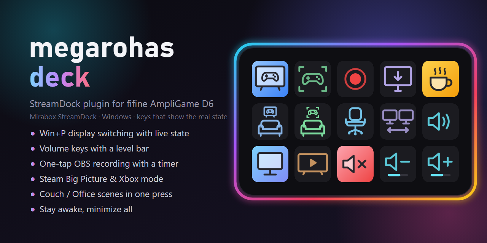</p>

<p align="center">
  <a href="https://github.com/megarohas/megarohas_deck/releases/latest"></a>
  
  
  
  
  <a href="LICENSE"></a>
</p>

<p align="center"><b>English</b> · <a href="#русский">Русский</a></p>

# megarohas deck

A plugin for the **fifine AmpliGame D6** stream controller (and other decks running the **Mirabox StreamDock** software)
that turns it into a couch-and-desk remote for a Windows gaming PC. Every key **shows the real state**: the active
screen mode lights up, the volume keys draw a level bar, the record key turns red and counts time, Big Picture,
Xbox mode and Playnite glow while they are open — even when you changed something with the keyboard instead of the deck.

One small `.exe`, no runtime to install (it uses the .NET Framework that ships with Windows), no background services.

## Keys

All keys live in the **megarohas** category of the deck software; drag them anywhere.

### Screens — like Win+P, but one tap

| Key | What it does |
|---|---|
| 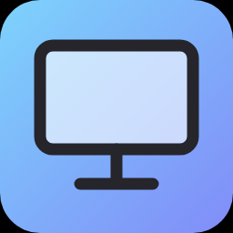 **Monitor only** | picture on the PC monitor only |
|  **TV only** | picture on the second screen (TV) only |
| 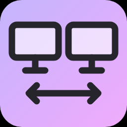 **Extend** | desktop across both screens |
| 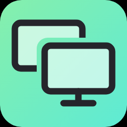 **Duplicate** | the same picture on both |

The key of the current mode is lit and follows changes made with Win+P. If a switch fails (TV off), the key shows an alert.

### Volume

| Key | What it does |
|---|---|
|  **Mute** | mute / unmute; turns red while muted |
| 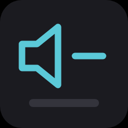 **Volume down** | one step per press, like the volume key on a keyboard, with the Windows volume flyout; the bar shows the level |
| 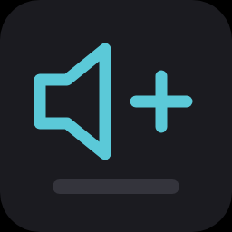 **Volume up** | the same, one step up |

Works with whatever output is the default right now (TV, headphones…).

### Recording

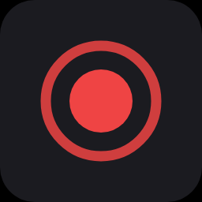 **Record screen** — one tap to start recording the
main screen with **OBS without opening its window**, even on top of Big Picture. OBS does not sit in the background:
the tap starts it minimized to the tray, straight on a `deck_record` scene that only captures the main screen, and the
second tap stops the recording and closes OBS again. An OBS you opened yourself is just used — it records on
`deck_record`, goes back to your scene and stays open. The key turns red with a running timer.
Needs OBS 28+ with the built-in WebSocket server enabled (*Tools → WebSocket Server Settings*); the plugin reads the
password from OBS's own config, nothing to type.

**Keep the webcam off:** tick *Deactivate when not showing* in the properties of your camera sources in OBS. Then the
camera only turns on in scenes that show it — never during a deck recording.

### Gaming modes

| Key | What it does |
|---|---|
| 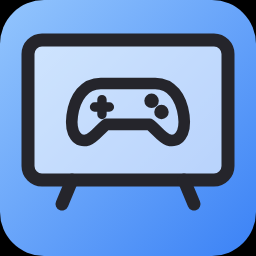 **Steam Big Picture** | open / close Big Picture; lit while it is open |
| 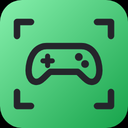 **Xbox mode** | toggle Windows 11 Xbox mode (formerly Xbox Full Screen Experience); lit while it is on |
| 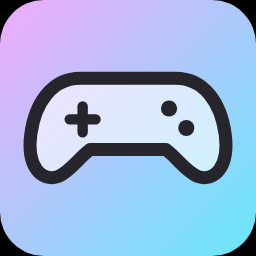 **Playnite** | open / close [Playnite](https://playnite.link) in fullscreen mode; lit while it is open |
| 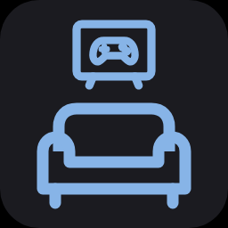 **Couch: Big Picture** | TV only → Big Picture |
| 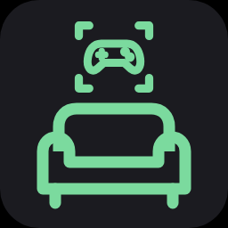 **Couch: Xbox mode** | TV only → Xbox mode |
| 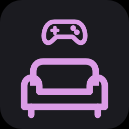 **Couch: Playnite** | TV only → fullscreen Playnite |
| 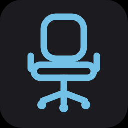 **Office** | back to the desk: leave Xbox mode, close Big Picture and fullscreen Playnite (the apps keep running), monitor only, minimize everything |

Big Picture, Xbox mode and fullscreen Playnite never run together: turning one on first turns the others off. Xbox mode
is detected with the official `IsGamingFullScreenExperienceActive()` API. Playnite is expected in its default folder
`%LOCALAPPDATA%\Playnite`; after its fullscreen mode closes, the plugin starts it again the way Windows autostart does, so
with *Start minimized* turned on it stays out of the way. Before a mode opens, the plugin closes the Start menu and
minimizes all windows, so nothing stays on top of it or keeps the focus.

### Windows

| Key | What it does |
|---|---|
| 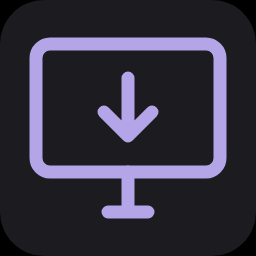 **Desktop** | minimize all windows for real (like Win+M — unlike Win+D they do not pop back on a stray click) |
| 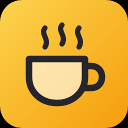 **Stay awake** | the screen does not turn off and the PC does not sleep while it is lit |

*Stay awake* starts/closes the tiny [NeSpat](https://github.com/megarohas/megarohas_windows_tweaks/tree/main/stayawake)
window app if it is installed in `%LOCALAPPDATA%\Programs\NeSpat`, otherwise the plugin holds the wake lock itself.

## Install

1. Download `megarohas_deck-vX.Y.Z.zip` from [Releases](https://github.com/megarohas/megarohas_deck/releases/latest) and unpack it.
2. Right-click `install.ps1` → **Run with PowerShell**. It copies the plugin to `%APPDATA%\HotSpot\StreamDock\plugins`
   and restarts the deck software.
3. Find the **megarohas** category in the actions list and drag keys onto the deck.

Manual install: copy the `com.megarohas.deck.sdPlugin` folder to `%APPDATA%\HotSpot\StreamDock\plugins` and restart
fifine Control Deck / StreamDock.

Tested on a fifine AmpliGame D6 with fifine Control Deck 3.10 on Windows 11. Other decks that use the Mirabox StreamDock
software (293V3, N3, N4, Ajazz AKP153…) should work too — the keys use the standard StreamDock SDK.

## Good to know (D6)

- **The RGB ring is hardware-only.** Neither the software's `lampControl` command (including the store's *RGB Control*
  plugin) nor the Mirabox HID LED commands change it on the D6. Use the button on the back: short press — next of the
  9 modes, long press — off/on.
- **Xbox button opens both Game Bar and the Big Picture menu?** Turn off *Settings → Gaming → Game Bar → Allow your
  controller to open Game Bar* (in Settings — writing `UseNexusForGameBarEnabled` to the registry is ignored).
- **OBS 32 "did not shut down properly / safe mode" prompt.** OBS 32 removed `--disable-shutdown-check`, and an OBS
  that did not close cleanly (Windows shut down with it running, a crash) leaves `run_*` marks in
  `%APPDATA%\obs-studio\.sentinel` — the next start then waits silently on a safe-mode dialog. The plugin deletes those
  leftovers (only while OBS is not running) before it starts OBS, so the start never gets stuck.
- **The deck software kills its plugins' children.** fifine Control Deck runs itself and every plugin inside a Windows
  job object, so anything a plugin starts directly dies (uncleanly) whenever the software restarts. The plugin starts OBS
  through WMI (`Win32_Process.Create`) instead, which puts it outside the job; starting it via `explorer.exe` from inside
  the job does not work.
- **Boot logo:** *Settings → Device → Replace boot logo* takes an 800×480 image shown through the 5×3 key windows
  (160 px per key). `bootlogo/make_bootlogo.py` draws grid-aware logos and a preview through the keys.

## Build from source

Nothing to install: the C# compiler of .NET Framework 4 ships with Windows.

```powershell
.\build.ps1      # src\*.cs -> com.megarohas.deck.sdPlugin\MegarohasDeck.exe
.\install.ps1    # copy into the deck software and restart it
```

Key images are SVG drawn by `make_icons.py` (Python standard library only) and rendered to PNG with headless Edge;
`docs/make_cover.py` draws the cover. Debugging: an empty `debug` file next to the installed exe makes the plugin log
every incoming message to `MegarohasDeck.log`.

| Path | |
|---|---|
| `src/Program.cs` | StreamDock WebSocket protocol, dispatch to modules |
| `src/Displays.cs` | screen modes (`SetDisplayConfig` / `QueryDisplayConfig`) |
| `src/Audio.cs` | volume through the shell's media-key commands (`WM_APPCOMMAND`), live level bar via Core Audio |
| `src/Record.cs` | OBS via obs-websocket v5 |
| `src/Gaming.cs` | Big Picture, Xbox mode, Playnite, Couch, Office |
| `src/Tools.cs` | Desktop, Stay awake |

## License

[MIT](LICENSE) © megarohas. Not affiliated with fifine, Mirabox, Valve or Microsoft.

---

<a id="русский"></a>

<p align="center"><a href="#megarohas-deck">English</a> · <b>Русский</b></p>

# megarohas deck (по-русски)

Плагин для стрим-деки **fifine AmpliGame D6** (и других дек на софте **Mirabox StreamDock**), который превращает её
в пульт игрового ПК — и для дивана, и для стола. Каждая кнопка **показывает настоящее состояние**: горит текущий
режим экранов, у громкости полоска уровня, кнопка записи краснеет и тикает временем, Big Picture, режим Xbox и Playnite светятся,
пока открыты — даже если ты переключил что-то с клавиатуры, а не с деки.

Один маленький `.exe`, ничего ставить не надо (используется .NET Framework, который уже есть в Windows), никаких служб.

## Кнопки

Все кнопки — в категории **megarohas** списка действий софта деки, перетаскиваются на любую клавишу.

### Экраны — как Win+P, но одним нажатием

| Кнопка | Что делает |
|---|---|
|  **Только монитор** | картинка только на мониторе компьютера |
|  **Только ТВ** | картинка только на втором экране (ТВ) |
|  **Расширить** | рабочий стол на оба экрана |
|  **Дублировать** | одна картинка на обоих |

Кнопка текущего режима горит и следит и за Win+P. Если переключиться не вышло (ТВ выключен) — значок ошибки.

### Громкость

| Кнопка | Что делает |
|---|---|
|  **Без звука** | выключить / включить звук; красная, пока звук выключен |
|  **Тише** | один шаг на нажатие, как клавиша громкости на клавиатуре, с плашкой громкости Windows; полоска показывает уровень |
|  **Громче** | то же, шаг вверх |

Работают с устройством вывода по умолчанию (ТВ, наушники…).

### Запись

 **Запись экрана** — одно нажатие, и основной экран
пишется через **OBS, не открывая его окно**, даже поверх Big Picture. В фоне OBS не висит: нажатие запускает его
свёрнутым в трей сразу на сцене `deck_record` (только захват основного экрана), повторное — останавливает запись и
закрывает OBS. Открытый вручную OBS плагин просто использует: пишет на `deck_record`, возвращает твою сцену и не
закрывает. Кнопка красная, на ней тикает время.
Нужен OBS 28+ с включённым встроенным WebSocket-сервером (*Инструменты → Настройки сервера WebSocket*); пароль плагин
берёт из конфига самого OBS, вводить ничего не надо.

**Чтобы вебкамера не включалась:** в OBS в свойствах источников камеры поставь галку *Отключать, когда не
отображается*. Тогда камера включается только на сценах, где она есть, и никогда — во время записи с деки.

### Игровые режимы

| Кнопка | Что делает |
|---|---|
|  **Steam Big Picture** | открыть / закрыть Big Picture; горит, пока открыт |
|  **Режим Xbox** | включить / выключить режим Xbox в Windows 11 (бывший Xbox Full Screen Experience); горит, пока включён |
|  **Playnite** | открыть / закрыть [Playnite](https://playnite.link) в полноэкранном режиме; горит, пока открыт |
|  **Диван: Big Picture** | только ТВ → Big Picture |
|  **Диван: режим Xbox** | только ТВ → режим Xbox |
|  **Диван: Playnite** | только ТВ → полноэкранный Playnite |
|  **Офис** | обратно за стол: выйти из режима Xbox, закрыть Big Picture и полноэкранный Playnite (сами приложения остаются запущенными), только монитор, свернуть всё |

Big Picture, режим Xbox и полноэкранный Playnite никогда не работают вместе: включение одного сначала выключает
остальные. Режим Xbox определяется официальной функцией `IsGamingFullScreenExperienceActive()`. Playnite ожидается в
стандартной папке `%LOCALAPPDATA%\Playnite`; после закрытия полноэкранного режима плагин запускает его заново, как
автозапуск Windows, и с настройкой запуска в свёрнутом виде он не мешает. Перед открытием режима плагин закрывает меню
Пуск и сворачивает все окна, чтобы поверх него ничего не оставалось и фокус не уходил.

### Windows

| Кнопка | Что делает |
|---|---|
|  **Рабочий стол** | сворачивает все окна по-настоящему (как Win+M — в отличие от Win+D окна не разворачиваются обратно от случайного клика) |
|  **Не спать** | пока горит, экран не гаснет и ПК не засыпает |

«Не спать» запускает/закрывает крошечное окно [NeSpat](https://github.com/megarohas/megarohas_windows_tweaks/tree/main/stayawake),
если оно установлено в `%LOCALAPPDATA%\Programs\NeSpat`; иначе плагин сам держит запрет сна.

## Установка

1. Скачай `megarohas_deck-vX.Y.Z.zip` со страницы [Releases](https://github.com/megarohas/megarohas_deck/releases/latest) и распакуй.
2. Правый клик по `install.ps1` → **Выполнить с помощью PowerShell**. Скрипт скопирует плагин в
   `%APPDATA%\HotSpot\StreamDock\plugins` и перезапустит софт деки.
3. В списке действий найди категорию **megarohas** и перетащи кнопки на деку.

Вручную: скопируй папку `com.megarohas.deck.sdPlugin` в `%APPDATA%\HotSpot\StreamDock\plugins` и перезапусти
fifine Control Deck / StreamDock.

Проверено на fifine AmpliGame D6 с fifine Control Deck 3.10 под Windows 11. Другие деки на софте Mirabox StreamDock
(293V3, N3, N4, Ajazz AKP153…) тоже должны работать — кнопки сделаны на стандартном StreamDock SDK.

## Полезно знать (D6)

- **RGB-кольцо управляется только кнопкой.** На D6 его не меняет ни команда `lampControl` софта (в том числе плагин
  *RGB Control* из магазина), ни HID-команды подсветки Mirabox. Кнопка на задней стороне: короткое нажатие — следующий
  из 9 режимов, долгое — выключить/включить.
- **Кнопка Xbox открывает и Game Bar, и меню Big Picture?** Выключи *Настройки → Игры → Game Bar → Разрешить контроллеру
  открывать Game Bar* (именно в настройках — запись `UseNexusForGameBarEnabled` в реестр не действует).
- **OBS 32 и окно «OBS неправильно завершил работу / безопасный режим».** В OBS 32 убрали `--disable-shutdown-check`,
  а OBS, закрытый не штатно (выключили Windows, пока он работал, или он упал), оставляет отметки `run_*` в
  `%APPDATA%\obs-studio\.sentinel` — следующий запуск молча висит на окне безопасного режима. Плагин удаляет эти
  остатки (только пока OBS не запущен) перед запуском OBS, поэтому старт не зависает.
- **Софт деки убивает потомков своих плагинов.** fifine Control Deck держит себя и все плагины в Windows Job, поэтому
  всё, что плагин запустил напрямую, умирает (аварийно) при каждом перезапуске софта. Плагин запускает OBS через WMI
  (`Win32_Process.Create`) — так он оказывается вне Job; через `explorer.exe` изнутри Job это не работает.
- **Загрузочная картинка:** *Настройки → Оборудование → Заменить логотип запуска* — 800×480, видна сквозь окна
  клавиш 5×3 (по 160 px на клавишу). `bootlogo/make_bootlogo.py` рисует логотипы под сетку и превью «сквозь клавиши».

## Сборка из исходников

Ставить ничего не надо: компилятор C# из .NET Framework 4 есть в Windows.

```powershell
.\build.ps1      # src\*.cs -> com.megarohas.deck.sdPlugin\MegarohasDeck.exe
.\install.ps1    # скопировать в софт деки и перезапустить его
```

Картинки кнопок — SVG из `make_icons.py` (только стандартная библиотека Python), в PNG через Edge в headless-режиме;
обложку рисует `docs/make_cover.py`. Отладка: пустой файл `debug` рядом с установленным exe — плагин пишет все входящие
сообщения в `MegarohasDeck.log`.

## Лицензия

[MIT](LICENSE) © megarohas. Проект не связан с fifine, Mirabox, Valve или Microsoft.
