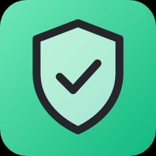
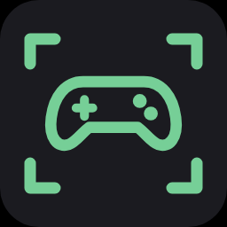

# megarohas deck

Личный плагин для стрим-деки **fifine AmpliGame D6** (софт fifine Control Deck). Подойдёт и к другим
декам на движке Mirabox StreamDock. В списке действий софта все кнопки лежат в категории **megarohas**.

## Экраны

Кнопки режима проецирования, то же, что **Win+P**:

| Кнопка | Режим |
|---|---|
|  **Только монитор** | только экран компьютера |
|  **Только ТВ** | только второй экран |
|  **Расширить** | рабочий стол на оба экрана |
|  **Дублировать** | одна картинка на обоих |

Кнопка текущего режима горит, остальные тусклые. Режим проверяется раз в секунду, так что
подсветка следует и за Win+P. Если переключиться не вышло (например, ТВ отключён), на кнопке мигает значок ошибки.

## Громкость

| Кнопка | Что делает |
|---|---|
|  **Без звука** | выключает / включает звук; горит красным, пока звук выключен |
|  **Тише** | −2% (удержание — непрерывно) |
|  **Громче** | +2% (удержание — непрерывно) |

Работают с устройством вывода по умолчанию (ТВ, наушники — какое выбрано сейчас). На ± кнопках полоска
текущего уровня; пока звук выключен, она серая. Изменение громкости заодно включает звук, как у клавиш Windows.

## Подсветка — только кнопкой на деке

RGB-кольцо D6 программно не управляется: ни команда `lampControl` софта (и его плагин RGB Control из магазина),
ни HID-команды Mirabox (`SETLB`/`LBLIG`) на него не действуют. Режимы переключает кнопка на задней стороне деки:
короткое нажатие — следующий режим (статичные цвета и анимации, всего 9), долгое — выключить/включить.

## Запись экрана

 **Запись экрана** — запись через OBS, не открывая его окно.
Если OBS не запущен, кнопка запускает его свёрнутым в трей. Плагин держит в OBS сцену `deck_record` с захватом
основного экрана (того, что сейчас на месте 0,0 — монитор или ТВ) и переключает на неё только на время записи,
потом возвращает прежнюю сцену. Пока идёт запись, клавиша красная, на ней тикает время. Файлы — куда пишет OBS
(`S:\obs_records`), звук — как настроен в OBS. Нужен включённый obs-websocket (Инструменты → Настройки сервера
WebSocket); пароль плагин берёт из его `config.json`. Запись, начатая в самом OBS, тоже подсвечивается.

## VPN (Hiddify)

 **VPN** — для Hiddify в режиме «Системный прокси». Горит, пока прокси
Windows указывает на ядро Hiddify (`127.0.0.1:12334`) и оно отвечает, то есть трафик идёт через VPN. Снаружи Hiddify
не управляется (нет API и CLI для запущенного приложения, deep-link `hiddify://` — только импорт профилей), поэтому
нажатие переключает сам системный прокси: выкл — трафик напрямую, вкл — снова через Hiddify. Сам Hiddify при этом
остаётся «подключённым». Если ядро Hiddify не запущено, нажатие открывает его окно — подключиться там.

## Игровые режимы

| Кнопка | Что делает |
|---|---|
|  **Steam Big Picture** | открывает / закрывает Big Picture (`steam://open/bigpicture`); горит, пока он открыт |
|  **Режим Xbox** | включает / выключает режим Xbox в Windows 11 (бывший Xbox Full Screen Experience) — это Win+F11 |
|  **Диван: Big Picture** | картинка только на ТВ, через 3 с — Big Picture (если ТВ уже был единственным экраном — сразу) |
|  **Диван: режим Xbox** | картинка только на ТВ, затем Win+F11; если ТВ не включился — значок ошибки и дальше не идёт |

## Мелочи Windows

| Кнопка | Что делает |
|---|---|
|  **Рабочий стол** | сворачивает все окна по-настоящему (`Shell.Application.MinimizeAll`, как Win+M): в отличие от Win+D окна не разворачиваются обратно случайным кликом |
|  **Не спать** | запускает свёрнутой / закрывает свою утилиту «Не спать» (`NeSpat.exe` из `%LOCALAPPDATA%\Programs\NeSpat`): пока она открыта, экран не гаснет и ПК не засыпает; горит, пока работает |

## Загрузочная картинка

`bootlogo/make_bootlogo.py` рисует варианты 800×480 под сетку клавиш и превью «сквозь клавиши». Стоит
`bootlogo/rink.png` (хоккейная площадка); ставится в софте: Настройки → Оборудование → «Заменить логотип запуска».

## Файлы

- `com.megarohas.deck.sdPlugin/` — сам плагин: `manifest.json`, `ru.json`, картинки; сюда же собирается `MegarohasDeck.exe`.
- `src/` — исходники exe: `Program.cs` (WebSocket-протокол StreamDock), `Displays.cs` (режимы экранов), `Audio.cs` (громкость),
  `Record.cs` (запись через obs-websocket), `Vpn.cs` (Hiddify), `Gaming.cs` (Big Picture, режим Xbox, «Диван»),
  `Tools.cs` («Рабочий стол», «Не спать»).
- `build.ps1` — сборка exe (csc из .NET Framework 4, ничего ставить не надо).
- `make_icons.py` — рисует картинки кнопок (SVG → PNG через Edge в headless-режиме, только стандартная библиотека Python).
- `install.ps1` — копирует плагин в `%APPDATA%\HotSpot\StreamDock\plugins` и перезапускает софт деки.

Отладка: пустой файл `debug` рядом с установленным exe — после перезапуска софта плагин пишет все входящие
сообщения и уровень громкости в `MegarohasDeck.log`; ошибки пишутся туда всегда.
